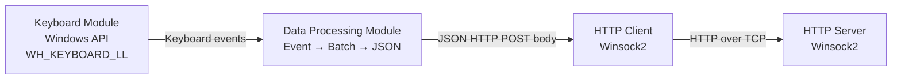
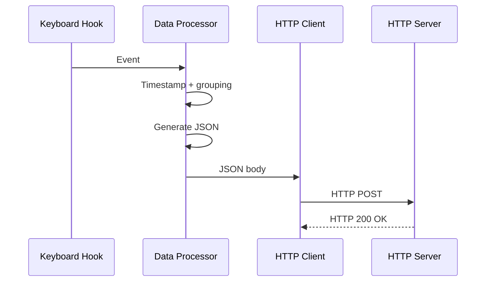

# Architektura systemu

## 1. Cel projektu

Celem projektu jest stworzenie aplikacji w języku C dla systemu Windows, demonstrującej globalną obsługę zdarzeń klawiatury oraz komunikację z serwerem z wykorzystaniem protokołu HTTP. System jest podzielony na moduły odpowiedzialne za obsługę zdarzeń, przetwarzanie danych i komunikację sieciową.

## 2. Architektura systemu



System składa się z trzech głównych modułów po stronie klienta oraz serwera HTTP używanego do testowania komunikacji. Moduły komunikują się ze sobą w ustalonej kolejności.

## 3. Moduł obsługi klawiatury

Moduł wykorzystuje Windows API oraz `WH_KEYBOARD_LL` do obsługi globalnych zdarzeń klawiatury. W przykładzie testowym reaguje wyłącznie na kontrolowane zdarzenie F12, w celu sprawdzenia działania mechanizmu hooka.

Przykładowe wykorzystywane elementy Windows API:
- `SetWindowsHookEx`
- `WH_KEYBOARD_LL`
- `KBDLLHOOKSTRUCT`
- `CallNextHookEx`
- `GetMessage`
- `PostQuitMessage`
- `UnhookWindowsHookEx`

## 4. Moduł przetwarzania danych

Moduł odbiera zdarzenia, nadaje im identyfikatory oraz zapisuje znacznik czasu z dokładnością do milisekund. Następnie grupuje zdarzenia w partie zawierające maksymalnie 10 elementów lub rozpoczyna nową partię, gdy przerwa między zdarzeniami przekroczy 5 sekund.

Przykładowa struktura zdarzenia:

```c
typedef struct {
    int event_id;
    char event_type[20];
    time_t timestamp;
    int milliseconds;
} Event;
```

Dane są następnie przygotowywane w formacie JSON, który może docelowo zostać wykorzystany jako treść żądania HTTP POST.

## 5. Moduł komunikacji sieciowej

Komunikacja jest realizowana przy użyciu Winsock2 oraz protokołu TCP. Klient samodzielnie tworzy żądanie HTTP POST i wysyła jego treść do serwera (działającego w przykładzie lokalnie na `127.0.0.1:8080`).

Serwer odbiera żądanie, odczytuje jego treść i zwraca odpowiedź `HTTP/1.1 200 OK`.

## 6. Przepływ danych



Przepływ rozpoczyna się od odebrania zdarzenia przez moduł klawiatury. Następnie dane są opatrywane znacznikiem czasu, grupowane i serializowane do JSON, po czym wysyłane przez klienta HTTP do serwera.

## 7. Stan obecnej implementacji

Obecnie przygotowano i przetestowano osobne przykłady dla Windows API, hooka klawiatury, Winsock2, serwera HTTP, klienta HTTP oraz przetwarzania danych. Środowisko programistyczne obejmuje CLion, CMake i kompilator MinGW.

Do wykonania pozostaje integracja trzech głównych modułów w jeden działający program.

## 8. Dalszy rozwój

Kolejnym etapem będzie połączenie modułu obsługi zdarzeń, przetwarzania danych i klienta HTTP. 

## 9. Obecne pytania
- Czy WH_KEYBOARD_LL jest wystarczająco Low-level? Czy bardziej iść w stronę Raw Input, RAWKEYBOARD etc?
- Czy lepiej używać WinHTTP jako windowsowej biblioteki obsługującej komunikację HTTP? Czy można zostać przy obecnym Winsock2 ?
- Po stronie serwera czy wdrożyć jakąś prostą bazę danych, np. poprzez DBMS MySQL w celu zapisywania otrzymanych batchów danych? Czy lepiej zapisywać do pliku tekstowego?
- Czy w module procesowania danych można w jakiś sensowny sposób wprowadzić identyfikację ciągów znaków, aby przesyłać na serwer np. zdania zamiast pojedynczych znaków?
- Czy umożliwić obsługę wielu klientów, a jednocześnie ich identyfikację w bazie danych/pliku tekstowym?